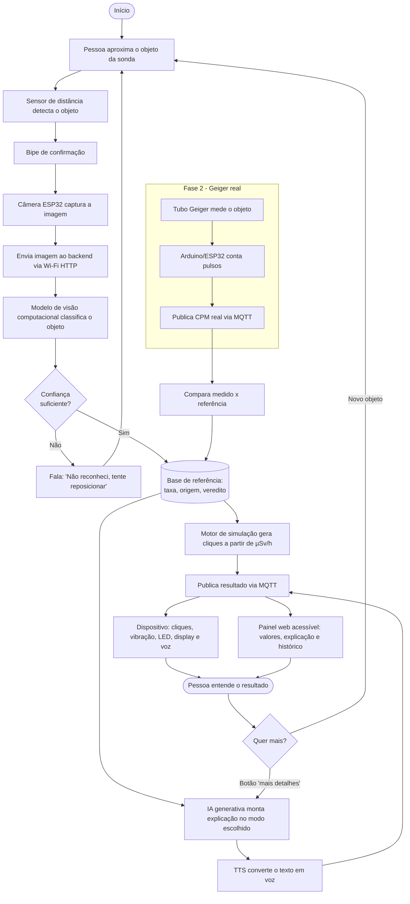

# CamGeiger IoT — Contador Geiger simulado por visão computacional

> **Disruptive Architectures: IoT, IoB & Generative IA** — 1º Sprint (proposta conceitual)
> **Grupo:** Efeito Fallout
> **Professor(a):** Bruno Henrique Oliveira Mulina 
> **Turma:** 2TDSPB

---

## 1. Contexto do projeto

**Projeto proposto (Marina):**  O problema mais presente identificado foi o baixo nível de conhecimento da população sobre energia nuclear. Isso ocorre principalmente pela falta de incentivo ao ensino do tema no país, já que o assunto raramente aparece de forma aprofundada nas escolas e nos meios de comunicação. Além disso, a desinformação e o medo associado a acidentes históricos, como Chernobyl, Fukushima e o césio-137 em Goiânia, reforçam mitos que misturam energia nuclear com armas nucleares e radiação perigosa. Soma-se a isso a pouca divulgação das aplicações positivas da tecnologia, como a geração de energia limpa, a medicina nuclear, a agricultura e a conservação de alimentos, o que mantém a população distante do assunto e vulnerável a informações incorretas.

**Como o CamGeiger se conecta a ele:** Propomos um dispositivo que simula o funcionamento de um medidor Geiger, tornando o aprendizado sobre radiação mais interativo e didático. Além disso, a solução é pensada para ser acessível a pessoas com deficiência visual, usando feedback sonoro e tátil.
 
---
 
## 2. Descrição da proposta
 
O **CamGeiger IoT** é um dispositivo interativo, com formato de **sonda de medidor Geiger**, que *finge* ser um contador Geiger para ensinar sobre radiação de forma lúdica e **acessível a pessoas com deficiência visual**.
 
A pessoa aproxima um objeto do aparelho e ele:
 
1. **Percebe a presença do objeto** (sensor de distância) e dispara a captura sozinho.
2. **Reconhece o objeto** pela câmera (ex.: banana, castanha-do-pará, relógio antigo, detector de fumaça, cerâmica).
3. **Consulta uma base de referência** com a radiação que esse tipo de objeto produz normalmente.
4. **Simula a leitura de um Geiger:** reproduz cliques mais ou menos rápidos conforme o valor, com vibração e luz acompanhando.
5. **Fala o resultado em voz:** diz o nome do objeto, o nível comparado ao fundo natural e uma explicação curta e didática.
> **Importante:** os valores são **simulados a partir de dados de referência**, não medidos. O aparelho avisa isso por voz e na tela.
 
### Princípio de design: ninguém depende de um único sentido
 
Toda informação sai por **pelo menos dois canais**, para atender pessoas com deficiência visual, auditiva ou baixa visão, e também crianças e idosos.
 
| Informação | Som | Voz | Tato | Visual |
|-----------|-----|-----|------|--------|
| Objeto reconhecido | Bipe de confirmação | Fala o nome | Vibração curta | Nome no display |
| Intensidade da "radiação" | Cliques mais rápidos | Fala a faixa (ex.: "próximo do fundo natural") | Vibração proporcional | LED de faixa + gráfico |
| Explicação didática | — | Fala o texto | — | Texto em alto contraste |
| Mito ou verdade | Som distinto para cada veredito | Fala o veredito | Padrões de vibração diferentes | Ícone + texto |
 
### Evolução em duas fases
 
| Fase | O que usa | Objetivo |
|------|-----------|----------|
| **Fase 1 (esta proposta)** | Câmera + reconhecimento + base de referência + simulação multissensorial | Entregar a experiência didática e acessível completa |
| **Fase 2 (futura)** | Fase 1 + módulo Geiger real (tubo + Arduino/ESP32) | Medir objetos de verdade e **comparar com a base de referência**, validando os dados |
 
### Necessidade atendida
 
- Tornar um tema que gera medo e desinformação **compreensível e tangível**.
- Garantir que **pessoas com deficiência visual participem** de atividades de divulgação científica em igualdade, o que costuma ser difícil com painéis e gráficos.
- Permitir demonstrações seguras, sem nenhuma fonte radioativa.
- Mostrar a cadeia IoT completa: sensores → rede → processamento → resposta ao usuário.
---
 
## 3. Componentes e tecnologias previstas
 
### 3.1 Dispositivos (hardware)
 
| Componente | Função | Onde instalar |
|-----------|--------|---------------|
| **Câmera** (ESP32-CAM ou webcam USB) | Captura a imagem do objeto | Na ponta da "sonda", apontada para a área onde o objeto é aproximado |
| **Sensor de distância** (ToF, ex.: VL53L0X, ou ultrassônico) | Detecta a presença do objeto e a distância; dispara a captura automaticamente e ajuda no enquadramento | Ao lado da câmera |
| **ESP32** (nó IoT) | Controla sensores, envia a imagem pela rede e recebe o resultado | No corpo do aparelho |
| **Alto-falante + amplificador** | Toca os cliques, os bipes e a **voz** | No corpo do aparelho |
| **Motor de vibração (háptico)** | Vibra na mão com intensidade e padrão proporcionais ao nível | No cabo/empunhadura |
| **Botões físicos grandes** com relevo e marcação em **Braille** | Controles: repetir explicação, mais detalhes, volume, modo de uso | No cabo, em posições fixas e distintas ao toque |
| **Display OLED/LCD de alto contraste** | Texto grande e ícones para baixa visão e pessoas surdas | Na parte superior do aparelho |
| **LED de faixa** (verde/amarelo/vermelho) | Indicação visual rápida do nível relativo | Na parte superior |
| **Módulo Geiger + tubo** *(Fase 2)* | Mede radiação real e envia pulsos | Ao lado da câmera |
 
### 3.2 Software e serviços
 
| Camada | Tecnologia prevista | Função |
|--------|--------------------|--------|
| Firmware do nó | C++ (Arduino IDE / PlatformIO) | Sensores, captura, áudio, vibração, botões, display |
| Reconhecimento de objetos | Python + modelo de visão computacional (ex.: MobileNet ou YOLO) | Classificar o objeto |
| Base de referência | Banco de dados (SQLite/PostgreSQL) | Objeto → taxa típica, origem, explicação, veredito e fonte do dado |
| Motor de simulação | Python | Converter µSv/h em CPM e gerar cliques com variação aleatória (Poisson), como um Geiger real |
| **IA Generativa** | LLM via API | Adaptar a explicação ao público (**modo criança, simples, detalhado**) e responder perguntas do usuário |
| **Texto para voz (TTS)** pt-BR | Serviço de TTS (online ou offline) | Falar o resultado e as explicações |
| Mensageria | **MQTT** (Mosquitto ou HiveMQ) | Entregar o resultado ao dispositivo e ao painel |
| Backend / API | Python (FastAPI) | Orquestrar reconhecimento, consulta, simulação, IA generativa e TTS |
| Painel web **acessível** | HTML semântico, ARIA, contraste e navegação por teclado (WCAG 2.1 AA) | Histórico e resultados, compatível com leitores de tela (NVDA, VoiceOver, TalkBack) |
| Versionamento | GitHub | Documentação e código |
 
### 3.3 Base de referência (o coração da simulação)
 
| Campo | Descrição |
|-------|-----------|
| `objeto` | Nome da classe reconhecida |
| `taxa_usv_h` | Taxa típica de dose (valor de referência) |
| `origem` | Fonte natural ou artificial (ex.: potássio-40, urânio, rádio) |
| `faixa` | Abaixo, próximo ou acima do fundo natural |
| `explicacao` | Texto curto e didático (alimenta a IA generativa e o TTS) |
| `veredito` | Mito ou verdade |
| `fonte_dado` | Referência bibliográfica (ex.: CNEN, IAEA, UNSCEAR) |
 
Os valores devem vir de fontes confiáveis, registradas com a referência, pois variam conforme a amostra.
 
---
 
## 4. Interação e didática
 
### Modos de uso
 
| Modo | Como funciona |
|------|---------------|
| **Explorar** | A pessoa aproxima objetos livremente e ouve o resultado e a explicação |
| **Quiz "mito ou verdade"** | O aparelho pergunta por voz se o objeto emite radiação; a pessoa responde com os botões e recebe a resposta com os cliques e a explicação |
| **Comparar** | Compara o objeto com o fundo natural ("esta banana está perto do ambiente, já aquele relógio antigo está mais alto") |
| **Aprender mais** | Botão de "mais detalhes" pede à IA uma explicação mais profunda ou mais simples |
 
### Recursos que tornam o uso mais didático
 
- **Sonificação:** a taxa de cliques traduz a intensidade, como num Geiger real, o que já é uma representação sonora natural.
- **Fundo natural como referência:** sempre há um "ruído de fundo" de cliques, e a pessoa percebe quando o objeto fica acima ou abaixo dele.
- **Linguagem adaptável:** a IA generativa ajusta o vocabulário (criança, adulto, estudante).
- **Guia de enquadramento por som:** bipes mais rápidos indicam que o objeto está bem posicionado, o que ajuda quem não vê a tela.
---
 
## 5. Comunicação
 
- **Meio:** Wi-Fi (IEEE 802.11) sobre TCP/IP, com o ESP32 conectado à rede local.
- **Envio da imagem:** HTTP POST do ESP32 para a API.
- **Retorno do resultado:** **MQTT**, com tópicos assinados pelo dispositivo e pelo painel. O áudio da voz pode ser enviado como arquivo gerado pelo backend ou reproduzido a partir de frases pré-gravadas armazenadas no aparelho (útil se a rede cair).
- **Segurança prevista:** TLS, autenticação no broker e identificador único por dispositivo. As imagens não precisam ser armazenadas, apenas o resultado da classificação.
```
camgeiger/<id_no>/resultado   → objeto, valores, veredito e explicação
camgeiger/<id_no>/audio       → referência do áudio da voz a ser tocado
camgeiger/<id_no>/status      → online/offline do dispositivo
```
 
```json
{
  "no": "node-01",
  "timestamp": "2026-11-05T14:30:00-03:00",
  "objeto": "banana",
  "confianca": 0.93,
  "usv_h": "<valor da base de referência>",
  "cpm_simulado": "<convertido pelo motor>",
  "faixa": "proximo_do_fundo",
  "veredito": "verdade",
  "modo_linguagem": "simples",
  "texto_falado": "Isto parece uma banana. Ela emite radiação natural, em nível muito baixo, parecido com o do ambiente.",
  "simulado": true
}
```
 
---
 
## 6. Fluxo dos dados e processamento
 
1. **Detecção:** o sensor de distância percebe o objeto e emite um bipe de confirmação.
2. **Captura:** a câmera tira a foto e o ESP32 a envia ao backend.
3. **Reconhecimento:** o modelo classifica o objeto e informa a confiança.
4. **Consulta:** o backend busca na base a taxa típica, a origem e o veredito.
5. **Simulação:** o motor gera a sequência de cliques com variação aleatória.
6. **Explicação:** a IA generativa monta o texto no modo escolhido, e o TTS o transforma em voz.
7. **Resposta multissensorial:** o dispositivo toca os cliques, vibra, acende o LED, mostra o texto e fala a explicação; o painel é atualizado.
8. **Fase 2:** o Geiger real mede o objeto e o sistema compara com o valor de referência.
### Fluxograma
 

 
---
 
## 7. Resposta gerada e benefícios
 
- **Experiência multissensorial** e autônoma: a pessoa não precisa ver a tela para usar.
- **Aprendizado ativo:** o modo quiz e a comparação com o fundo natural estimulam a interação.
- **Combate à desinformação:** cada resposta traz o veredito de mito ou verdade e a origem do dado.
- **Painel acessível** para professores e mediadores acompanharem o uso.
### Benefícios
 
- Inclusivo desde o projeto, e não como adaptação posterior.
- Seguro: nenhuma fonte radioativa na Fase 1.
- Baixo custo e hardware acessível.
- Modular e escalável (novos objetos e idiomas na base).
- Forte potencial para museus, escolas e eventos de divulgação científica.
### Limitações
 
- **Não é uma medição real:** o valor é uma referência típica, e cada objeto pode variar.
- A precisão depende do reconhecimento: objetos parecidos podem ser confundidos.
- A qualidade depende da qualidade e da fonte dos dados da base.
- Depende de rede e de boa iluminação para a captura (mitigado com frases pré-gravadas e iluminação própria).
- Deve sempre avisar que se trata de uma simulação educativa.
- A acessibilidade precisa ser **validada com usuários reais**; as escolhas do projeto são hipóteses até o teste.
---
 
## 8. Validação com usuários (próximas etapas)
 
- Testar protótipos com pessoas com deficiência visual e com mediadores de instituições de apoio, ajustando voz, velocidade da fala, posição dos botões e padrões de vibração.
- Medir se a pessoa consegue usar o aparelho sozinha e se compreende o conteúdo (ex.: acertos no quiz antes e depois).
---
 
## 9. Roadmap
 
- [x] Sprint 1: proposta conceitual, componentes, comunicação e fluxograma
- [ ] Montar a base de referência com fontes citadas
- [ ] Protótipo de reconhecimento de objetos
- [ ] Motor de simulação, áudio, voz e vibração
- [ ] Painel web acessível
- [ ] Testes com usuários
- [ ] Integração do módulo Geiger real e comparação
---
 
## 10. Estrutura do repositório
 
```
camgeiger/
├── README.md                 
├── docs/
│   └── fluxograma.png        
└── (código será adicionado nas próximas sprints)
```
 
---
 
## 11. Integrantes
 
| Nome | RM | Responsabilidade |
|------|----|------------------|
| Andre Matuda | 566733 | IOT |
| Guilherme Barca | 568517 | Java/.NET |
| Guilherme Feitosa | 56842 | Compilance |
| Kaliel Aquino | 567587 | Mobile |
| Andre Matuda | 567618 | Devops/Data Base |
 
## 12. Vídeo de apresentação
 
[PREENCHER: link do YouTube (não listado)]
